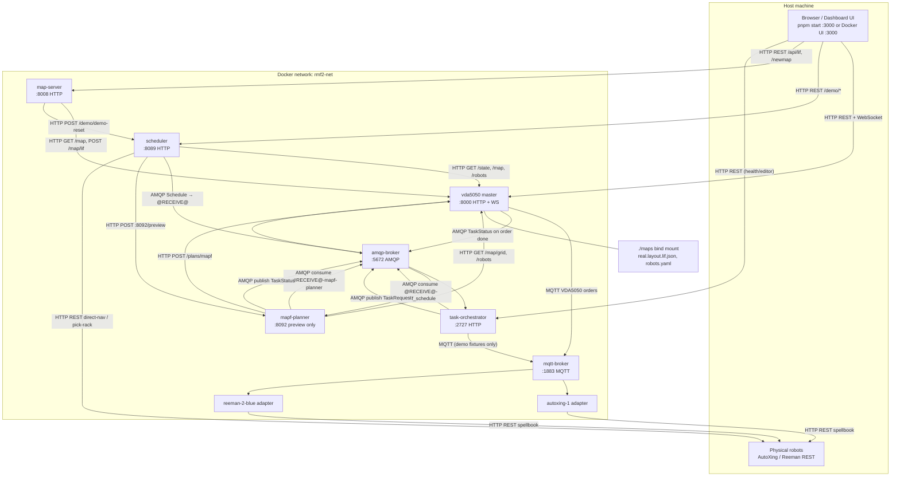
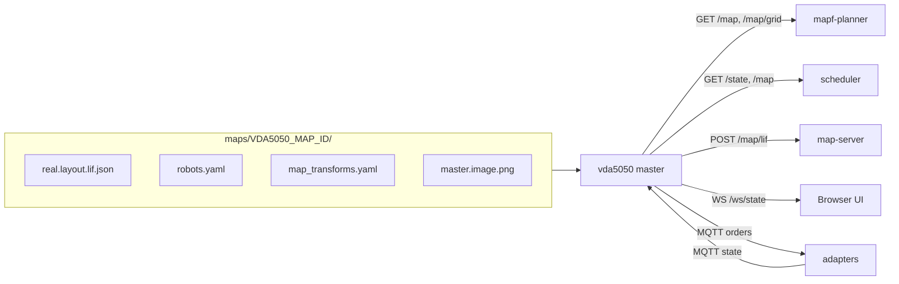
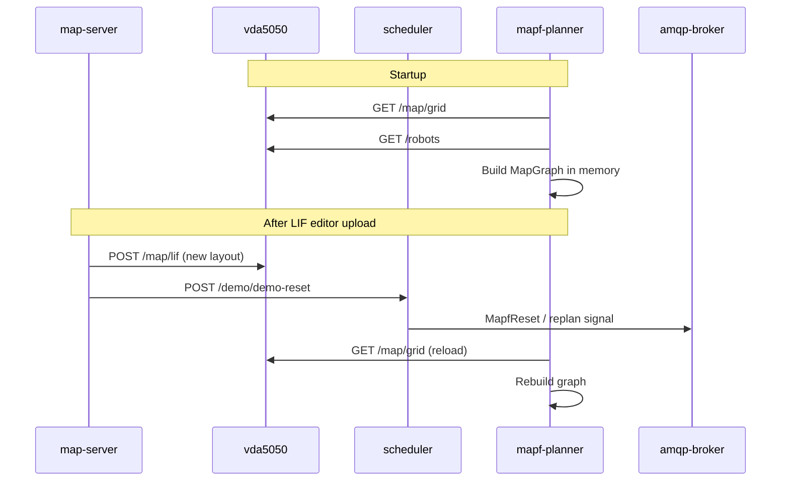
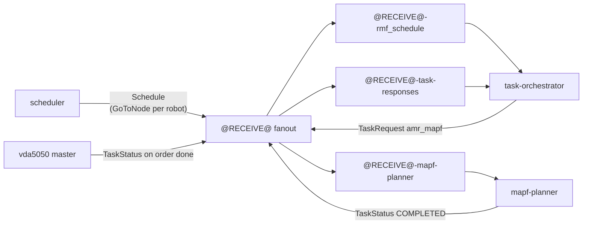
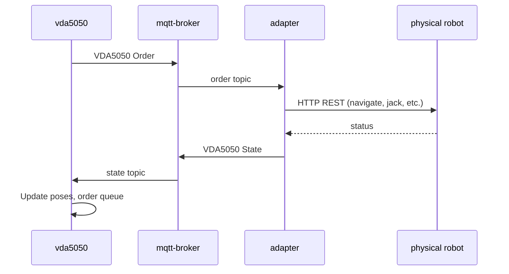
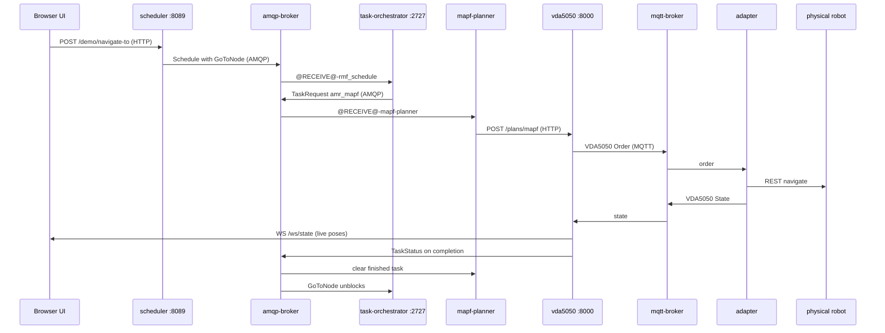
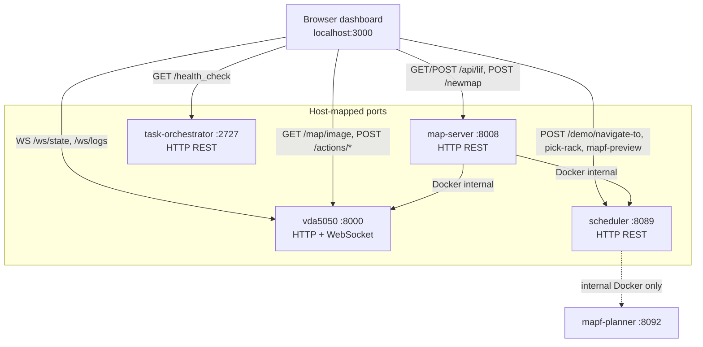
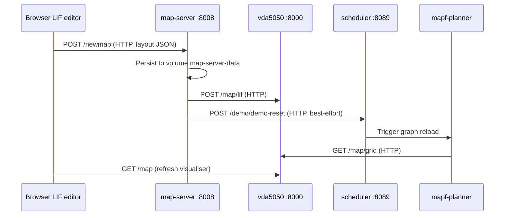
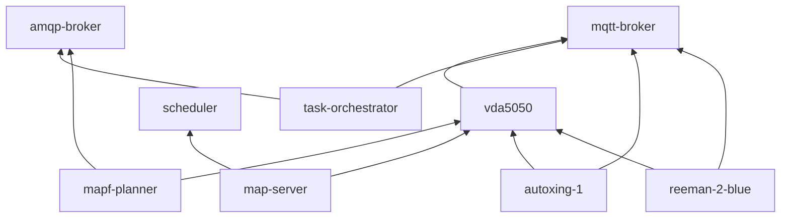

# Blue Ocean Stack — Docker Communication Architecture

Single compose file: `docker-compose.yml`. All services share the **`rmf2-net`** bridge network (`rmf2_demo_gametl_rmf2-net`). Inside Docker, services reach each other by **DNS name** (`vda5050`, `scheduler`, `amqp-broker`, …). The browser/UI runs on the **host** and uses **localhost ports** mapped from containers.

---

## Container inventory

| Service | Role | Host port | Internal port | Headless? |
|---------|------|-----------|---------------|-----------|
| **mqtt-broker** | Mosquitto — VDA5050 robot I/O | `1883` | `1883` | No |
| **amqp-broker** | RabbitMQ — workflow + MAPF messaging | `5672`, `15672` (mgmt UI) | same | No |
| **vda5050** | VDA5050 master — map authority, orders, live state | `8000` | `8000` | No |
| **scheduler** | Demo FastAPI gateway (`/demo/*`) | `8089` | `8089` | No |
| **task-orchestrator** | Crossflow workflow executor (Rust/Bevy) | `2727` | `2727` | No |
| **mapf-planner** | CBS multi-agent path planner | *(none)* | `8092` preview only | Yes |
| **map-server** | LIF editor persistence + map upload | `8008` | `8008` | No |
| **autoxing-1** | AutoXing VDA5050 adapter | *(none)* | — | Yes |
| **reeman-2-blue** | Reeman VDA5050 adapter | *(none)* | — | Yes |
| **ui** | Dashboard (nginx static SPA) | `3000→80` | — | **Commented out** |

**Not in stack:** PostgreSQL, Redis, gRPC, stack-level API gateway.

**Outside Docker:** physical robots on the LAN (`maps/<VDA5050_MAP_ID>/robots.yaml` → `endpoint` per robot).

---

## Protocols used

| Protocol | Where | Purpose |
|----------|-------|---------|
| **HTTP REST** | UI ↔ services, inter-service control | Maps, navigation, missions, health |
| **WebSocket** | UI ↔ VDA5050 master | Live robot poses, map, MQTT debug logs |
| **MQTT** | Master ↔ adapters (Mosquitto) | VDA5050 orders + state |
| **AMQP** | Scheduler, orchestrator, MAPF, master (RabbitMQ) | Schedules, task requests, task status |
| **Filesystem** | `./maps` bind mount → `vda5050` | LIF layout, robots.yaml, map images |

---

## High-level topology



---

## VDA5050 master — single map authority

Everything that needs topology, robot profiles, transforms, or live poses ultimately talks to **`vda5050`**.

| Source | What it reads/writes |
|--------|----------------------|
| **Filesystem** | `maps/${VDA5050_MAP_ID}/real.layout.lif.json`, `robots.yaml`, `map_transforms.yaml`, `master.image.png` |
| **mapf-planner** | `GET /map/grid`, `GET /robots`, `POST /plans/mapf` |
| **scheduler** | `GET /state`, `GET /map`, `GET /robots` |
| **map-server** | `GET /map` (startup), pushes `POST /map/lif` on upload |
| **adapters** | `GET /robots`, `/transform`, `/map` at startup |
| **UI** | `GET /map`, `/map/image`, `/plans/mapf`, `/actions/*`, `WS /ws/state`, `WS /ws/logs` |



---

## How MAPF gets maps

MAPF does **not** read `./maps` directly. It pulls topology from the master at startup and on reset:

1. **Startup** — `mapf-planner` waits for `vda5050` healthy, then:
   - `GET http://vda5050:8000/map/grid` → node graph (ids, edges, departure blockers)
   - `GET http://vda5050:8000/robots` → robot profiles (footprint, start nodes)
2. **Runtime** — listens on AMQP queue `@RECEIVE@-mapf-planner` for `TaskRequest` messages (`task_type: amr_mapf`).
3. **Planning** — CBS + `MAPFCoordinator` on the grid graph.
4. **Output** — `POST http://vda5050:8000/plans/mapf` with waypoints per robot.
5. **Reload** — after LIF editor upload → map-server → master → scheduler `POST /demo/demo-reset` → planner re-fetches `/map/grid`.



---

## AMQP message bus (RabbitMQ)

| Exchange | Type | Queues | Message types |
|----------|------|--------|---------------|
| `@RECEIVE@` | fanout, durable | `@RECEIVE@-rmf_schedule` | `Schedule` (orchestrator) |
| | | `@RECEIVE@-mapf-planner` | `TaskRequest` (`amr_mapf`) |
| | | `@RECEIVE@-task-responses` | `TaskStatus` (orchestrator listener) |



---

## MQTT (Mosquitto) — robot I/O

| Participant | Role |
|-------------|------|
| **vda5050** | Publishes VDA5050 **orders**; subscribes to **state** |
| **autoxing-1**, **reeman-2-blue** | Subscribe to orders; publish state |
| **task-orchestrator** | MQTT only for demo `MQTTDeviceReqNode` fixtures (not primary nav) |

Topic pattern: `uagv/v2/{manufacturer}/{serial_number}/...`



Adapters resolve identity at startup from master (`ROBOT_ID` env only):

- `GET /robots` → manufacturer, serial, `endpoint`
- `GET /transform` → frame calibration (Reeman → AutoXing)
- `GET /map` → onboard map alignment

---

## Primary navigation flow (MAPF path)

UI → scheduler → AMQP → orchestrator → AMQP → MAPF → master → MQTT → adapter → robot.



---

## Bypass paths (no MAPF)

| Path | Flow | Protocol |
|------|------|----------|
| **Direct navigate** | UI → scheduler `/demo/direct-navigate` → spellbook REST on robot IP | HTTP only |
| **Pick rack** | UI → scheduler `/demo/pick-rack` → AutoXing spellbook on robot IP | HTTP only |
| **MAPF preview** | UI → scheduler `/demo/mapf-preview` → mapf-planner `:8092/preview` | HTTP only (no dispatch) |
| **Minimal stack** | `docker compose up mqtt-broker vda5050 autoxing-1 reeman-2-blue` | MQTT + master only |

---

## How the UI gets information

The UI service is **commented out** in compose. Typical dev: `pnpm start` on the host at `:3000`. **Nginx serves static files only** — no API reverse proxy. The browser calls each backend **directly on localhost ports**.

### Build-time env (`Dockerfile` / `.env.production`)

| Env var | Default target | Used for |
|---------|----------------|----------|
| `VITE_RTS_BASE` | `http://localhost:8089` | Scheduler `/demo/*` |
| `VITE_BROKER_STATUS_BASE` | `http://localhost:8000` | VDA5050 master + WebSocket |
| `VITE_RTO_BASE` | `http://localhost:2727` | Task orchestrator |
| `VITE_API_BASE_URL` | `http://localhost:8008` | Map server (LIF editor) |

WebSocket URLs are derived from the master base (`use-vda-state.ts`):

```ts
const WS_URL =
  (BrokerStatusConfig.BASE ?? 'http://localhost:8000').replace(/^http/, 'ws') +
  '/ws/state';
```

### UI → backend matrix

| UI feature | Endpoint | Protocol |
|------------|----------|----------|
| Live map + robot poses | `ws://localhost:8000/ws/state` | WebSocket |
| MQTT debug log tap | `ws://localhost:8000/ws/logs` | WebSocket |
| Map backdrop image | `GET :8000/map/image/meta`, `/map/image` | HTTP |
| Jack up/down, instant actions | `POST :8000/actions/*` | HTTP |
| Navigate, missions, pick-rack, preview | `POST :8089/demo/*` | HTTP |
| LIF load/save/publish | `GET/POST :8008/api/lif`, `POST /newmap` | HTTP |
| Network health page | `GET :8089/docs`, `:8000/status` | HTTP |
| Orchestrator editor/health | `GET :2727/health_check` | HTTP |



---

## LIF map editor upload flow



---

## Service dependency graph (compose `depends_on`)



---

## Quick reference — who talks to whom

| From | To | Protocol | Data |
|------|-----|----------|------|
| UI | vda5050 | HTTP + WS | Map, poses, actions, plans |
| UI | scheduler | HTTP | Demo missions, nav, pick-rack |
| UI | map-server | HTTP | LIF CRUD, publish map |
| scheduler | vda5050 | HTTP | Live state, topology |
| scheduler | amqp-broker | AMQP | GoTo schedules |
| scheduler | mapf-planner | HTTP | MAPF preview |
| scheduler | robots (LAN) | HTTP | Direct nav, spellbook |
| task-orchestrator | amqp-broker | AMQP | Schedules in, TaskRequests out |
| mapf-planner | vda5050 | HTTP | Grid, robots, plans |
| mapf-planner | amqp-broker | AMQP | TaskRequests in, TaskStatus out |
| map-server | vda5050 | HTTP | Map sync |
| map-server | scheduler | HTTP | Planner reset after upload |
| vda5050 | mqtt-broker | MQTT | VDA5050 orders/state |
| vda5050 | amqp-broker | AMQP | Order completion → MAPF |
| adapters | vda5050 | HTTP | Identity, map, transform |
| adapters | mqtt-broker | MQTT | VDA5050 I/O |
| adapters | robots (LAN) | HTTP | Navigate, jack, pick |

---

## Minimal vs full stack

**Full stack** (default):

```bash
docker compose up --build
```

**VDA5050 only** (no scheduler, MAPF, orchestrator):

```bash
docker compose up --build mqtt-broker vda5050 autoxing-1 reeman-2-blue
```

In the minimal stack, the UI can still connect to `:8000` for live visualisation; navigation via MAPF/scheduler is unavailable.
